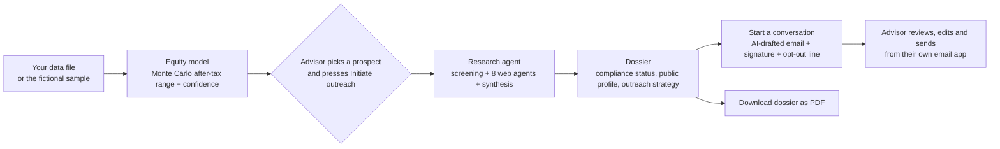

# Origin: prospect intelligence for private-wealth advisors

Origin helps a private bank's relationship managers decide **who to talk to and how to start the conversation** among employees of high-growth startups that are approaching a liquidity event. It estimates each person's after-tax equity position from public information, runs a compliance-aware research agent on demand, and drafts a warm, low-pressure first email for the advisor to review.

> **No prospect data ships with this repository.** When you open the app it asks you to upload your own file, or you can try a small sample of **fictional** data: 14 made-up people at 2 made-up companies, with invented company figures. Everything Origin shows about a person is a modeled estimate or a compilation of public sources. It is not verified net worth, not tax or legal advice, and not a substitute for your firm's KYC, sanctions or compliance process. Read [Ethics and Intended Use](#9-ethics-and-intended-use) before pointing it at real people.

## Contents

1. [Problem Statement](#1-problem-statement)
2. [Solution Overview](#2-solution-overview)
3. [Key Features](#3-key-features)
4. [AI Integration](#4-ai-integration)
5. [External Tools & Datasets](#5-external-tools--datasets)
6. [Installation & Setup](#6-installation--setup)
7. [Using Your Own Data](#7-using-your-own-data)
8. [AI Safety & Limitations](#8-ai-safety--limitations)
9. [Ethics and Intended Use](#9-ethics-and-intended-use)
10. [Project Structure](#10-project-structure)
11. [Third-party Software](#11-third-party-software)

---

## 1. Problem Statement

**The problem.** Employees of private, high-growth startups often hold very large equity stakes that are illiquid on paper but become real money at tender offers, IPOs and vesting events. Their financial planning needs change sharply around those moments.

**Who experiences it.**

- **Private-bank relationship managers and business developers** have no efficient way to find these people early, judge who is worth a conversation, or approach them well. Today it means hours of manual searching, guessing at what someone's equity might be worth, and sending generic outreach that gets ignored.
- **Compliance teams** worry about the opposite failure: unvetted outreach to people who may be sanctioned, politically exposed or the subject of adverse news, and research that wanders into private matters.
- **The prospects themselves** are best served by respectful, relevant, professional contact that is honest about who is writing and why, and that is easy to decline.

**Why it is worth solving.** Equity-rich technologists are an under-served client segment, and the quality of a first impression matters. Doing this research by hand is slow and inconsistent, and doing it carelessly creates real privacy and regulatory risk. A tool that is fast, explains its assumptions, keeps a human in the loop and builds compliance and transparency into the workflow addresses both the commercial and the ethical side of the problem.

## 2. Solution Overview

Origin is a local web application with three stages that mirror an advisor's workflow.



1. **Load data and prioritise.** The dashboard opens with two upload sections, one for your prospects and one for the company details the model needs, and a small fictional sample is one click away. After a short loading animation it ranks prospects by *modeled* after-tax equity (with a P10 to P90 range and a confidence level), filterable by company and minimum threshold. Every assumption (vesting, taxes, tender offers, share prices) is visible on the card and in a methodology panel.
2. **Research on demand.** Only when the advisor presses **Initiate outreach**, an agent screens the person against sanctions and PEP lists, searches court records, publications and public developer profiles, and runs web-research agents for press, podcasts, writing, talks and business interests. It returns one dossier with a compliance status and a suggested outreach strategy. Anything it cannot tie to a retrieved source is dropped.
3. **Start the conversation.** The advisor enters their sign-off details and employer name, and a language model drafts a friendly invitation to coffee or a short call based on the dossier's outreach strategy. The advisor reads and edits it, then opens it in their own email app. Every email ends with a transparency and opt-out line. Nothing is ever sent automatically.

## 3. Key Features

**Prospect dashboard**
- **Opens with two separate upload sections** in the space where the loading animation plays: **1 Prospects** and **2 Company profiles**, each with its own file chooser and downloadable template. A file is checked and previewed before it loads. Once both are in, the loading animation plays and the ranked cards appear. You can also **continue without company profiles** (prospects then show n/a), or **try the sample data** (14 fictional prospects at 2 made-up companies) in one click.
- **Your data stays in your browser.** Files are read as data, never executed and never uploaded. **Replace prospects** and **Replace company profiles** swap one part at a time (the animation plays again), and **Load different data** forgets everything and returns to the prompt.
- Ranking by modeled net equity, tenure or name; search; company filters built from the loaded data; minimum-equity threshold; pagination; distribution snapshot.
- Cards flip to show the assumptions behind each estimate; a details dialog explains every flag.
- Records with impossible data (for example a start date before the company existed), or at a company with no profile, are shown as **n/a** rather than guessed. The sample includes one so you can see it.

**Equity model**
- Company-agnostic: everything specific to an employer (funding rounds, vesting, trigger structure, tender offers, pay ladder) lives in a **company profile** that comes from your data file. The model has **no built-in company data**: a company without a profile is listed but not estimated.
- 1,500-scenario Monte Carlo per person over pay level, grant sizing, refresh grants, share price and tender participation.
- Handles cliff and year-by-year vesting, single- and double-trigger RSUs, tender offers and US tax treatment (San Francisco profile by default).
- Outputs a P10/P50/P90 after-tax range, a pre-tax value, a confidence rating and plain-language flags (early hire, approximate role mapping, flagged founder, incomplete name).

**Outreach research agent**
- Streams live progress as each tool and agent runs.
- Sanctions and PEP screening, public court records, publications, developer profile.
- Eight web agents: professional profile, press coverage, writing, podcasts, social posts, video and talks, legal/adverse media, and business interests. (There is deliberately **no forum or community-discussion agent**: see [Ethics](#9-ethics-and-intended-use).)
- One dossier with a **compliance status** (clear, review, hold, not screened), an outreach strategy, data gaps and a source list.
- Download as a formatted **PDF**, copy a short brief, or export JSON.

**Start a conversation**
- A details window collects first name, last name, pronouns, job title, **employer name**, email and phone.
- The AI drafts a warm, low-pressure email that mentions your employer by name. You review, edit, regenerate, copy, or open it in your email app (`mailto:`).
- The signature is added in the browser in exactly this format:

  ```
  First name Last name (pronouns)
  Job title
  Phone number
  Email address
  ```

- **Every email then carries a transparency and opt-out line**, so the recipient learns how they were found and how to stop hearing from you:

  > Why you're hearing from me: I found your name via public professional information. Not interested? Reply "no thanks" and I won't contact you again and will delete your details. Happy to share what I hold about you.

  If you delete the line while editing, the app warns you. Edit its wording in `compose.js` if it is not accurate for how your firm obtained the person's details.

**Privacy and accountability**
- Nothing runs until a human presses a button. Keys stay on the server. A compliance hold blocks email drafting.
- An audit log records each research run and email draft, **expires automatically after 30 days**, and can be erased per person or entirely with one command ([Data retention and deletion](#data-retention-and-deletion)).

## 4. AI Integration

### Where AI is used

| # | Component | What the AI does | Model | Settings |
|---|-----------|------------------|-------|----------|
| 1 | **Web research agents** (8 topics: profile, press, writing, podcasts, social, video, legal/adverse media, business interests) | Searches the live web (or reads Firecrawl pages) and returns structured findings, each with a source URL, a date and a match-confidence with reasons | Claude Sonnet 5.5, via OpenRouter's web-search plugin (or the model vendor's own API) | Temperature 0.2, JSON output |
| 2 | **Synthesis agent** | Reads only the verified evidence and writes the executive summary, profile summary, career highlights, an outreach strategy (angle, conversation starters, channel, timing, things to avoid) and a list of data gaps | Claude Sonnet 5.5 | Temperature 0.2, JSON output |
| 3 | **Email drafting agent** | Writes a short, warm invitation from the outreach strategy and a few high-confidence public items, mentioning the sender's employer by name | Claude Sonnet 5.5 | Temperature 0.7, JSON output, up to 3 attempts |

Override the model with `OUTREACH_MODEL`.

### Where AI is deliberately **not** used

- **Equity estimates** come from a transparent statistical model (`equity-model.js`), not a language model. Pay bands are mapped from titles by explicit rules, so every number can be traced.
- **Sanctions and PEP screening** is done by the OpenSanctions matching API. The LLM never decides whether someone is sanctioned.
- **Court, publication and code lookups** are plain API calls with deterministic identity checks (employer affiliation, name compatibility).
- **Reading your data file** is plain parsing and validation code. The file is never run, and no model sees it.
- **Compliance gating, privacy filters, grounding checks and tone validation** are code, applied *around* the model's output.
- **PDF assembly, the signature and the opt-out line** are produced in the browser, not by the model.

### How the AI is controlled

- The agents run **only on a button press**, never in the background and never in bulk.
- The model is told to use **only retrieved sources**; every finding's URL is checked against what was actually retrieved, and unsupported items are dropped.
- Every model output is parsed as JSON and **validated in code** before it is shown.
- The email draft is **always shown for review**; the app never sends mail.
- The sender's name, pronouns, job title, phone and email are **never sent to the model**. The only sender detail it receives is the employer name, which must appear in the body.
- Equity figures, wealth hints, screening results and legal findings are **withheld from the email model**.

## 5. External Tools & Datasets

### APIs and services

| Service | Used for | Key needed | Notes |
|---------|----------|-----------|-------|
| [OpenRouter](https://openrouter.ai/) running **Claude Sonnet 5.5** | Research agents, synthesis, email drafting, live web search | `OPENROUTER_API_KEY` | Required for live mode. The provider receives the researched person's name and public snippets, so review its data-handling terms |
| The model vendor's own API | Alternative to OpenRouter | a vendor key (see `.env.example`) | Used only if no OpenRouter key is set |
| [OpenSanctions](https://www.opensanctions.org/api/) | Sanctions, PEP and watchlist matching | `OPENSANCTIONS_API_KEY` | Strongly recommended. Check licence terms for commercial use |
| [CourtListener](https://www.courtlistener.com/help/api/) (Free Law Project) | Public federal court dockets | `COURTLISTENER_TOKEN` (optional) | Token only raises rate limits |
| [OpenAlex](https://openalex.org/) | Publications and author matching | none (optional contact email) | Open data |
| [GitHub REST API](https://docs.github.com/rest) | Public developer profile | `GITHUB_TOKEN` (optional) | Token only raises rate limits |
| [Firecrawl](https://www.firecrawl.dev/) | Deeper page scraping for web agents | `FIRECRAWL_API_KEY` (optional) | If unset, the model's built-in web search is used |
| [USPTO Open Data Portal](https://developer.uspto.gov/) | Patent filings | `USPTO_API_KEY` | **Disabled by default.** Enable with `USPTO_ENABLED=true` |
| Google Fonts | The *Plus Jakarta Sans* typeface | none | The only third-party request the browser makes on page load |

### Datasets and reference data

| Data | How it is used |
|------|----------------|
| **Sample data pack** (`templates/sample-data-pack.js`) | A small, hand-written, **fictional** data set: 14 numbered "Demo Person" prospects at 2 made-up companies, with invented funding rounds, vesting, tenders and pay ladders. It reads no real data. It includes a few deliberate cases (an early hire, a flagged founder, one impossible start date) so every feature has something to show. Every figure is a placeholder, not market data |
| **Templates** (`templates/prospects-template.js`, `templates/company-profiles-template.js`) | Commented examples of the two file formats for your own prospects and company profiles |
| **Your own files** (optional) | A prospects file and a company profiles file, loaded in the two upload sections ([section 7](#7-using-your-own-data)). You supply and are responsible for these figures |
| **A candidate CSV** (optional) | Converted by `tools/import-prospects.js` into a prospects file. Not included in this repository; only use data you are allowed to hold |
| **US federal, California and New York tax rates** | Marginal-rate assumptions in the tax model |

### Software

Node.js built-ins only at runtime (no `npm install` needed), plus [jsPDF](https://github.com/parallax/jsPDF) 4.2.1 (MIT), bundled in `vendor/` for PDF export.

## 6. Installation & Setup

### Prerequisites

- **Node.js 22.9 or newer** (developed and tested on Node 24). Check with `node --version`. Download from [nodejs.org](https://nodejs.org/).
- A modern browser (Chrome, Edge, Firefox or Safari).
- For live research: an OpenRouter API key (see step 3).
- There are **no runtime dependencies**, so `npm install` is not required.

### Step by step

**1. Get the code**

```bash
git clone <your-repository-url>
cd <repository-folder>
```

**2. Create your environment file**

```bash
# macOS / Linux
cp .env.example .env

# Windows (PowerShell)
Copy-Item .env.example .env
```

**3. Add your keys to `.env`**

Open `.env` in a text editor. The file is documented line by line. At minimum:

| Goal | What to fill in |
|------|-----------------|
| Just look around (sample data, no API calls) | Nothing. Skip to step 4 and use demo mode (`npm run start:mock`) |
| Live research and email drafting | `OPENROUTER_API_KEY` ([get one](https://openrouter.ai/keys)) |
| Proper compliance screening | Also `OPENSANCTIONS_API_KEY` |
| Everything else | Optional. Leave blank or commented out |

> `.env` is git-ignored. **Never commit it, and never paste keys into code or issues.**

**4. Start the app**

```bash
npm start            # live mode (uses the keys in .env)
npm run start:mock   # demo mode: synthetic dossiers and emails, no keys and no API calls
```

On Windows PowerShell, if `npm` is blocked by script-execution policy, use `npm.cmd start`.

You should see `Origin is running at http://127.0.0.1:8787/app.html` followed by the audit-log retention setting.

**5. Open it**

- Dashboard: <http://127.0.0.1:8787/app.html>
- Landing page: <http://127.0.0.1:8787/>

The page must be opened **through the server**. Opening `app.html` directly from disk will not work because the research agent needs the local API.

**6. Try it**

1. The page asks for data: click **Try the sample data**, or choose your own file. The loading animation plays, then the ranked prospects appear.
2. Click **Details** on any prospect.
3. Click **Initiate outreach** and watch the agents work (a few seconds in demo mode).
4. When the dossier appears, click **Download dossier (PDF)** or **Start a conversation**.
5. Fill in your sign-off details and employer name, review the drafted email, then **Open in email app**.

> The sample prospects are made up, so **live** research on them will correctly find nothing. Use demo mode (`npm run start:mock`) to try the full flow, or load your own lawful data ([section 7](#7-using-your-own-data)) to run live research.

### Run the tests

```bash
npm test
```

All 96 tests use stubbed network calls and temporary folders, so they need no keys and cost nothing.

### Optional: live check of the email writer

```bash
node --env-file=.env tools/check-email-live.js
```

Makes two real model calls on a **fictional** dossier so you can read the model's output. Uses a little of your API credit.

### Deploy a hosted demo to Vercel (optional)

Vercel can host a **demo-only** copy of Origin: the static site plus small serverless functions that always run in mock mode. Visitors can try the sample data and see synthetic research results and email drafts. **No API keys, no live lookups and no real people are involved**, and the demo shows a banner saying so. (The full live app needs a long-running server and a login, so it is not supported on Vercel. Run it locally with `npm start`.)

1. **Commit and push** the project to GitHub. A private repository is fine. `private/`, `.env` and `logs/` are git-ignored and never leave your machine.
2. On [vercel.com](https://vercel.com), choose **Add New, then Project**, and import the repository.
3. Leave the settings as detected: `vercel.json` already sets the build command (`node tools/build-demo.js`), the output folder (`public`) and the security headers. **You do not need to add any environment variables.**
4. Press **Deploy**. When it finishes, open `https://<your-project>.vercel.app`. The landing page is at `/` and the dashboard at `/app.html`.
5. Check it: the yellow demo banner shows, **Try the sample data** works, **Initiate outreach** returns a synthetic dossier after about five seconds, and `/api/health` shows `"mock": true`.

Prefer the command line? Run `npm install -g vercel`, then `vercel login`, `vercel` (a preview) and `vercel --prod`. `.vercelignore` keeps private files out of the upload.

Good to know:
- The demo functions delete any keys found in their environment and refuse to start unless mock mode is on, so a settings mistake cannot make the public demo run live research.
- Anyone can open the URL. Visitors' own files are read only in their browser, but tell them to use fictional data. To limit access, use Vercel's Deployment Protection settings (availability depends on your plan) or a custom domain with your own login in front.
- Vercel's free Hobby plan is intended for personal, non-commercial use. Check their current terms before using it to show investors.
- `npm run build:demo` builds the same `public/` folder locally so you can inspect exactly what would be published (16 files).


### Troubleshooting

| Symptom | Fix |
|---------|-----|
| "Could not reach the local research service" | The server is not running, or you opened the file directly. Run `npm start` and use the `http://127.0.0.1:8787` address |
| `EADDRINUSE` / "Port 8787 is already in use" | Stop the other process or set `PORT=8788` in `.env` |
| Every research step says "skipped" | Keys were not loaded. Check that `.env` is in the project root, then restart |
| OpenRouter 401 or 402 error | Key invalid or out of credit. Check it on openrouter.ai |
| "Open in email app" does nothing | No default email application is configured. Use **Copy email** instead |
| Changed `.env` but nothing happened | Restart the server; `.env` is read at startup |
| My file will not load | The dialog says why. The usual causes are single quotes instead of double quotes, a trailing expression or function in the data, or a date that is not `YYYY-MM-DD` |

## 7. Using Your Own Data

You do **not** need to edit any code to use your own prospects. When you open the dashboard it shows **two separate upload sections**:

| Section | File | What it holds |
|---------|------|---------------|
| **1 Prospects** | `window.RAW_PROSPECTS = [ ... ];` | One object per person: name, company, title, start date and a few optional fields |
| **2 Company profiles** | `window.COMPANY_PROFILES = { ... };` | One profile per employer: the facts the equity model needs |

Each section has its own file chooser (or drop zone) and its own commented template: [`templates/prospects-template.js`](templates/prospects-template.js) and [`templates/company-profiles-template.js`](templates/company-profiles-template.js). Load them in either order. When both are in, the loading animation plays and the ranked results appear. If you only have prospects, **Continue without company profiles** lists them all as n/a. Once data is loaded, **Replace prospects** and **Replace company profiles** in the toolbar swap one part at a time.

Each section reads **only its own part** of a file, so a single file containing both parts (like the sample) works in either section. A file in the wrong section is refused with a pointer to the right one. A minimal prospect looks like this:

```js
window.RAW_PROSPECTS = [
  { "name": "Example Person 1", "company": "Example Corp", "title": "Software Engineer", "startDate": "2022-03-01" }
];
```

| Prospect field | Required | Meaning |
|----------------|----------|---------|
| `name`, `company`, `title` | yes | The company must match a company name in your company profiles file |
| `startDate` | yes | `YYYY-MM-DD`. A date before the company's founding year is shown as n/a |
| `seniority`, `department`, `subDepartment` | no | Used for tags and search; a missing department is flagged |
| `tenure` | no | Years at the company; worked out from `startDate` when left out |
| `founder` | no | `true` marks a founder: a low-confidence placeholder estimate |
| `city` | no | Shown on the card. Taxes are modeled for a San Francisco resident either way |

A **company profile** describes one employer: `foundedYear`, `referenceValuationB`, `curve` (funding rounds: date, price per share, valuation), `priceRef` (the price range used to value equity today), `vesting` (share vesting per year and an optional cliff), `structure` (single- or double-trigger), `tenders` (employee tender offers) and `levels` (a pay ladder of average stock value per year, lowest first). An optional `roleBands` overrides the generic band for a role. The app checks every profile and tells you what is wrong. A prospect at a company with **no** profile is still listed, but is shown as n/a and not estimated, because inventing numbers would be misleading.


### The dialog tells you what it found

Before anything is loaded you see a preview. For a prospects file: how many prospects were read, which rows were skipped and why, and for each company whether a company profile is already loaded. For a company profiles file: which profiles are valid, which loaded prospects each one covers, and which prospects would still show n/a. Press **Load** to confirm. Then the loading animation plays and the ranked results appear. **Load different data** (shown on the page afterwards) forgets everything and returns to the prompt.

### How your file is handled

- **It is read as text, never run as code.** A script you load could otherwise do anything the page can do. Origin finds the data values in the file, parses them as JSON and validates every field. Statements, functions and expressions in the file are ignored or refused, and the page's Content-Security-Policy would block them anyway. Comments and trailing commas are tolerated; single-quoted text is not (it is not valid JSON).
- **It never leaves your browser.** Parsing happens on the page, and the data is held in memory and in the tab's session storage so a reload keeps it. It is forgotten when you close the tab or choose Load different data. It is not saved to disk, uploaded or logged.
- **Fields are whitelisted and cleaned.** Unknown fields are dropped, control characters are removed, lengths are capped, duplicate rows are skipped, and files are limited to 5 MB and 5,000 rows.
- **Everything from the file is shown as plain text.** The page escapes names, titles and profile text, so a hostile file cannot inject markup or script.
- **Only one person at a time is sent anywhere.** When you press **Initiate outreach**, that person's name, company, title and start date go to your local server and to the research services you enabled.

### Building a file from a CSV

```bash
node tools/import-prospects.js "path/to/your_candidates.csv"
```

This cleans a CSV with the columns `Name, Company, Title, Seniority, Department, SubDepartment, StartDate, TenureYears` and writes a prospects file to the git-ignored `private/` folder (or to a path you give as a second argument, for example `node tools/import-prospects.js "my.csv" private/my-prospects.js`). It never writes inside the app, and the output can be loaded in the **Prospects** section. It has no company profiles: write them from your own sources (see the company profiles template) and load them in the **Company profiles** section. Only import data you are entitled to hold. To keep someone out of an import (for example after an erasure request), add `"Company|Name"` to the `EXCLUDED` list in `tools/import-prospects.js`.

### Using real companies

The sample's company figures are invented placeholders. For real estimates, build a profile for each employer from sources you are licensed to use (funding-round prices, compensation benchmarks, news about tenders) and check them. Keep real profiles and real prospect lists out of any public repository; the git-ignored `private/` folder is a good place for them.

## 8. AI Safety & Limitations

### Risks identified and how they are addressed

| Risk | Why it matters | Guardrail implemented |
|------|----------------|-----------------------|
| **Hallucinated facts or sources** | A made-up article or "fact" in a dossier could mislead an advisor or embarrass the bank | Findings must cite a URL that the search actually returned; unsupported items are dropped and counted in a data-gaps note. Missing tools are shown as *skipped*, never faked |
| **Mistaken identity** (common names, namesakes) | Attributing someone else's lawsuit or post to a prospect is harmful | A finding is attributed to the person only when at least two identifiers agree (employer, role, field, location). Weak matches are separated under *low-confidence possible matches* |
| **Over-collection of personal data** | Profiling people can become intrusive and unlawful | Public, professional sources only. No logging in, no paywall or access-control bypass. A code filter drops anything touching family, health, religion, politics, sexual orientation, immigration status or home address. Emails and phone numbers in model output are masked. **Forums and community discussions are not searched at all**, because pseudonymous accounts are easy to misattribute and threads are often gossip |
| **Missed sanctions or compliance problems** | Contacting a sanctioned or politically exposed person is a serious breach | OpenSanctions screening on every run. Status is *clear*, *review*, *hold* or *not screened*. **A hold blocks email drafting entirely**; review or not-screened requires the user to confirm clearance. Incomplete names are flagged as unreliable to screen. The screening is advisory and name-based only |
| **Creepy or pushy outreach** | A message that reveals the sender has been estimating the recipient's wealth damages trust | The email prompt forbids any mention of wealth, equity, pay, valuations, liquidity, taxes, family or research. Strategy text and findings touching those topics are removed *before* the model sees them. The output is then checked by a validator (banned topics, pushy phrases, placeholders, length, greeting, employer mention); a failing draft is retried with the reasons and, after three failures, the app shows an error instead of a bad draft |
| **Recipient not told how they were found, or how to opt out** | A message that hides its basis, or gives no way to say no, is unfair to the recipient and breaches many marketing and privacy rules | The email states plainly that the sender works in private banking at their named employer, and **every email ends with a transparency and opt-out line** (how they were found, "reply no thanks", a promise of no further contact, erasure, and access). The app warns if the line is removed |
| **A malicious or malformed data file** | An uploaded script could run in the page, or hostile text could inject markup | The file is **parsed as data and never executed**; only values that are valid JSON are accepted; fields are whitelisted, cleaned and length-capped; size and row limits apply; every string from the file is escaped when shown (a test loads a deliberately hostile file and checks that nothing runs or is injected). The page's Content-Security-Policy forbids inline and uploaded scripts as a second layer |
| **Wrong company figures producing wrong estimates** | An estimate is only as good as the profile behind it | The model has **no built-in company data**: a prospect at a company with no profile is shown as n/a. The sample's figures are labelled invented. Profiles are validated (dates in order, vesting adds up to 100, pay ladder rising, tender fields complete) and the dialog reports problems before anything loads |
| **Leaked secrets** | Keys in code or the browser can be stolen | Keys are read only on the server from `.env` (git-ignored), never sent to the browser, and never appear in streamed events, dossiers or drafts (a test asserts this). A scan confirmed no real key appears anywhere in the code, and test fixtures use obviously fake keys |
| **Leaking the sender's own details to the AI** | Unnecessary data sharing | Name, pronouns, title, phone and email stay in the browser; only the employer name is sent. A test and a browser check assert this |
| **Prompt injection through the employer field or web pages** | Untrusted text could steer the model | The employer name is restricted to plain text (no control characters, markup or links). Web content is treated as evidence to be summarised, and all outputs are validated and grounded in code |
| **Over-trusting the equity estimate** | A modeled number can be read as fact | Always labelled "Modeled, not verified". Shown as a range with a confidence rating and explicit flags. Impossible records are shown as n/a. Flagged founders are marked as underestimated |
| **Real people exposed in a public repository** | A list of named people with wealth estimates could help scammers or stalkers | **No prospect data ships with the repository**: the only data files are a template and a 14-person fictional sample. Real data lives in your browser tab or the git-ignored `private/` folder (the CSV importer writes there by default); dossiers, PDFs, audit logs and `.env` are git-ignored |
| **Personal data kept indefinitely** | Old research on named people is a liability and breaches data-minimisation rules | The audit log **expires after 30 days** automatically (configurable) and supports per-person and total deletion. The server never writes dossier contents to disk, and uploaded data is never written to disk at all |
| **Web attacks on the local server** | The API fetches data and calls paid services | Binds to localhost by default; same-origin and header checks on the POST APIs; a whitelist of servable files; a strict Content-Security-Policy (`script-src 'self'`); request-size limits, concurrency limits and timeouts; HTML-escaping of all model- and data-derived text |
| **No record of who researched whom** | Accountability | Every research run and email draft is written to a local audit log (`logs/outreach-audit.jsonl`, git-ignored), within the retention limit |

### Data retention and deletion

**What is stored, and where**

| Data | Where | How long |
|------|-------|----------|
| Audit entries: time, name and company researched, compliance status, step outcomes, number of sources | `logs/outreach-audit.jsonl` on the server | **30 days by default**, then deleted automatically |
| The dossier itself (findings, summary, strategy) | In the browser tab's memory only | Until you close or reload the page. The server does not save it |
| Data you loaded (your file or the sample) | The browser tab's memory and session storage | Until you close the tab or choose Load different data |
| Downloaded PDF or JSON dossiers and sent emails | Wherever you save them or send them | Your responsibility. Delete them per your firm's policy |
| Your sign-off details | Your browser's local storage, only if you leave "Remember these details" ticked | Until you untick it, or clear site data |

**Automatic retention.** On startup and every six hours the server deletes audit entries older than `AUDIT_RETENTION_DAYS` (default `30`). Set it to `0` to turn automatic deletion off (not recommended). Entries without a readable timestamp are deleted too, since their age cannot be verified.

**Deletion on request** (for example when someone replies "no thanks" or exercises an erasure right):

```bash
npm run audit -- list                                  # show what is stored (names, dates, status only)
npm run audit -- delete --name "Jane Roe"              # erase every entry about one person
npm run audit -- delete --name "Jane Roe" --company "Company A"
npm run audit -- purge --days 7                        # delete anything older than 7 days now
npm run audit -- delete-all --yes                      # erase the whole log
```

Run these while the server is idle. Honouring a request also means removing the person from your own prospect list (add them to `EXCLUDED` in `tools/import-prospects.js` or remove their row from your data file), your CRM and your mailbox. The tool cannot reach those.

### Testing done

**Automated (`npm test`): 96 tests across 10 files, no keys or network required.**

| File | Tests | What it covers |
|------|-------|----------------|
| `tests/pipeline.test.js` | 8 | End-to-end research pipeline with every external API stubbed: grounding, dropping hallucinated URLs, sensitive-content and PII filtering, low-confidence separation, sanctions hold, missing-key behaviour, **API keys never appear in output**, USPTO disabled by default, press and podcast agents, and that **no forum agent exists or is queried** |
| `tests/email.test.js` | 11 | What the model is and is not given (wealth, legal and screening data never reach it), the banned-topic validator, retry and fail-closed behaviour, the compliance gate (hold, review, not screened), the HTTP endpoint (headers, cross-origin rejection, status codes), employer-name validation and injection attempts |
| `tests/compose.test.js` | 8 | The exact signature format, **the transparency and opt-out line (present once, after the signature, with every promised element)**, cleaning and validation of the details form, safe `mailto:` links (encoding, line breaks, blocked header injection) and that a realistic email still fits in a link |
| `tests/audit.test.js` | 10 | **Retention and deletion**: append, purge by age, unreadable entries, retention settings (default, custom, off), startup purge, per-person erasure that spares similar names, delete-all, no stray temp files, and the command-line tool including the `--yes` safeguard |
| `tests/datapack.test.js` | 15 | **The data-file loader**: both templates and the sample pack load; **each section reads only its own part of a file**; accepted shapes; comments and trailing commas; **a file with code in it is read but never run, and code in place of data is refused**; clear errors for empty, oversized, broken or unrecognised files; bad rows skipped with row numbers; duplicates; unknown fields dropped; hostile text kept as plain text; the dialog never uses `innerHTML` |
| `tests/model.test.js` | 16 | **The model starts empty** (no built-in company data; an unknown company is n/a); **the fictional sample** (14 numbered people, 2 companies, one impossible date, flags for the founder and the early hire); the **company-profile mechanism** (data-driven vesting, valid and invalid profiles with readable reasons, prototype-name tricks, explicit levels in titles, role-band overrides, seniority ordering); impossible start dates are never estimated |
| `tests/server.test.js` | 6 | **The upload-first flow**: no bundled prospect-list file exists in the app; the page opens with two upload sections (prospects first, then company profiles) where the loading animation starts; **there is no Skip animation or Simulate loading button**; loading data starts the animation; the server serves the sample pack and both templates but refuses private files, `.env`, server code and path tricks; the sample and templates contain no real-looking data |
| `tests/import.test.js` | 4 | **The CSV importer**: cleaning, duplicates and incomplete names; its output loads back through the same loader; it writes only where you say (default: the git-ignored `private/` folder) and never inside the app |
| `tests/vercel.test.js` | 14 | **The hosted demo**: `vercel.json` carries the same security headers as the local server; the build publishes exactly the whitelisted files and refuses to delete the project; the demo functions **always run in mock mode, strip any API keys from their process, make no network calls, and refuse to start if the server was loaded in live mode**; the same-site check works over HTTPS and still rejects other sites; request bodies are read correctly whether the host pre-parses them or not; the page shows a demo banner |
| `tests/pdf.test.js` | 4 | PDF generation, pagination of very long content, only `http(s)` links are clickable, text normalisation and safe file names |

**Manual verification during development** (scripts are not part of this repository):
- Headless-browser walkthroughs in Microsoft Edge against the demo server: opening dialogs, form validation, generating a draft, the generated `mailto:` link, the opt-out line and its removal warning, PDF download, and a check for console errors and Content-Security-Policy violations. The browser check also confirmed that the sender's personal details are not in the request to the server.
- **Upload walkthroughs**: the first-visit prompt with its two sections; the sample data; the loading animation playing before the results (with no way to skip it); prospects first then company profiles, and the other way round; continuing without company profiles; replacing one part from the toolbar; a file put in the wrong section, refused with a pointer to the right one; loading from a combined file; Load different data; surviving a reload; a broken file refused with a clear message; and a **deliberately hostile file** (script statements, markup in names and in profile text, an alert attempt). Nothing ran, nothing was injected, and no console or Content-Security-Policy errors appeared.
- A HTML-escaping check with hostile strings.
- Live runs of the email writer on a fictional dossier. It wrote warm, specific emails that mentioned the employer naturally and ignored wealth and tender hints placed in the strategy text as bait.
- A scan of every file for real secret values from `.env`: none found. A scan confirming that no real company or person names remain in the repository.

### Known limitations

**Equity model**
- It is an **estimate from public data**, not a verified holding. Real grants, refresh grants, prior sales, taxes and departures are unknown.
- The sample's company figures are **invented**. Real estimates are only as good as the profiles you supply, and those figures go stale as companies raise money and run tenders.
- Pay bands come from a level ladder you provide. **Bands for non-engineering, director and VP roles are rougher guesses** (scaled from the ladder) and are flagged as approximate.
- Titles and seniority labels in a source can be wrong or stale. The model refuses to estimate an impossible start date and shows n/a.
- Founders and very early hires often hold stakes far above pay-band estimates; this is flagged, not modeled.
- Trigger structure and tender caps are assumptions unless you can verify them.
- Tax assumes a US resident at top marginal rates (San Francisco by default). It ignores QSBS, AMT, charitable gifts, reinvestment and non-US residency.

**Research agent**
- Language models can still misattribute or misread sources despite grounding checks. **A human must verify before acting.**
- Web search coverage is uneven. "Nothing found" does not mean "nothing exists". Paywalled and login-only content (including most of LinkedIn) is not available.
- Sanctions screening is a name-based fuzzy match. It produces false positives and false negatives and **does not replace** your compliance team's KYC and sanctions process.
- Court search covers US federal dockets only.
- The sensitive-topic filter is keyword-based, so it can miss paraphrases.
- Incomplete names in a source (an initial or a single name) make identification unreliable.
- The language-model provider and any search provider you enable process the researched person's name. They are data processors you must vet.

**Email drafting**
- Drafts can contain errors or awkward phrasing, so the advisor must read every one.
- The prospect's email address is not in the dossier (it is stripped by the privacy filter), so the To field is left for you to fill.
- Some email apps truncate very long `mailto:` links; the app warns and offers Copy.
- The opt-out line is a promise **you** must keep. The tool does not receive replies, track opt-outs, or maintain a suppression list.

**Data loading**
- Data files must be valid JSON inside the file (double quotes, no expressions). Hand-written JavaScript object literals with unquoted keys are not accepted.
- A loaded file lives in one browser tab. Very large files may not survive a reload (the page tells you).

**General**
- A single-user, local tool with no login or access control. Do not expose it to a network. For the same reason the **Vercel deployment is demo-only** (synthetic results, no keys, no live lookups); live research is not supported on a public URL.
- PDF export uses built-in fonts, so characters outside Western European languages become `?`.
- Cost and speed depend on your model provider: each research run makes about nine model calls and each draft one to three.

## 9. Ethics and Intended Use

Origin profiles people who have not asked to be profiled. That is the central ethical fact about it, and the rest of this section is about using it responsibly.

### Intended use

- **Who:** relationship managers, business developers and compliance staff at a regulated private bank or wealth manager.
- **What for:** deciding which professionals at high-growth startups to introduce yourself to, preparing a respectful and relevant first message, and checking basic compliance status before contact.
- **How:** one person at a time, with a human reading every result, and a human deciding whether and how to make contact.
- **On what data:** a prospect list you are legally entitled to hold, plus public professional information.

### Not intended for

- Decisions about a person's eligibility for credit, employment, insurance, housing or services.
- Bulk, automated or unattended outreach, or mass profiling.
- Researching private individuals, minors, or anyone outside a legitimate business-development purpose.
- Stalking, harassment, pressure, fraud, or social engineering of any kind, including identifying wealthy targets for crime.
- Contacting anyone who has opted out, or any person on a compliance hold.
- Quoting a person's estimated wealth or equity back to them.
- Use as a sanctions, KYC or anti-money-laundering control.

### Design principles and what they look like in the code

| Principle | How it is applied |
|-----------|-------------------|
| **Human in the loop** | Research starts only on a click; the email is only ever a draft; compliance holds block drafting |
| **Honesty toward the recipient** | The email names the sender's employer, the signature carries real contact details, and the opt-out line explains how they were found. The tool never impersonates anyone and refuses placeholders and fabricated details |
| **Easy to say no** | Every email tells the recipient how to opt out and promises no further contact and erasure. Messages are written to be easy to decline, with no urgency or pressure |
| **Data minimisation** | Public professional sources only; sensitive categories filtered; **forum and community-discussion research removed**; the email model never sees wealth, legal or screening data; the sender's details never reach the model; uploaded data stays in the browser tab |
| **Limited retention** | Audit log expires after 30 days; per-person erasure command; dossiers are not stored server-side; no prospect data in the repository |
| **Accuracy and humility** | Estimates are ranges with confidence and flags; findings need sources; weak matches are separated; impossible data and unprofiled companies are n/a |
| **Safe by construction** | Loaded files are parsed as data and never run; everything shown from a file is escaped |
| **Accountability** | An audit log shows who was researched and when, and every compliance override is a deliberate confirmation |

### Ethical tensions we want you to see

- **Profiling without consent.** Even from public inputs, an estimate of someone's net worth is a new, sensitive inference. We reduce harm (ranges, labels, no sharing with the email model, short retention) but cannot remove it. Whether it is acceptable depends on your jurisdiction, your lawful basis and your firm's policy.
- **The email does not lead with *why* a person was chosen.** It is truthful (it says who the sender is and why they are writing in general terms) and the opt-out line discloses how the name was found, but it does not say "you were selected because of your estimated equity". Some readers will consider that fair first-contact practice; others will not. If your firm's policy or local law requires fuller disclosure, extend the line or the first paragraph, and answer honestly if asked.
- **Personalisation can feel like surveillance.** The draft may reference a public talk or post. We keep this to one light, professional item and never to private matters, but a recipient may still wonder how you found it. The footer is there to answer that question up front.
- **The model can be wrong in ways that hurt.** A misattributed lawsuit or a false sanctions match could reach a dossier. Human review and the safeguards above lower this risk; they do not eliminate it.
- **Wealth targeting.** A ranked list of wealthy individuals is valuable to a bank and to criminals alike. Keep real data off public repositories and shared drives, and restrict who can run the tool.
- **Bring-your-own-data shifts responsibility to you.** The app cannot tell whether a file you load was lawfully obtained. That judgement, and the duty to honour opt-outs, is yours.

### Before using it on real people

Treat this checklist as a minimum, not legal advice. Involve your legal and compliance teams.

1. **Lawful basis and data provenance.** Know where your prospect list came from and that you may process it for this purpose (for example legitimate interests with a documented balancing test, or consent). Do not use data obtained in breach of a website's terms or privacy law.
2. **Privacy notice and impact assessment.** Complete a data-protection impact assessment where required, and make sure people are told what you hold and why (the email footer helps but is not a full notice).
3. **Marketing and e-privacy rules.** Check consent, sender-identification and unsubscribe requirements for every country you contact (for example CAN-SPAM, GDPR/PECR, CASL). Provide a postal address if your law requires one.
4. **Processor agreements.** Review the data-handling and retention terms of OpenRouter (or the model vendor), OpenSanctions, Firecrawl and any other service you enable.
5. **Opt-outs and erasure.** Decide who monitors replies to the opt-out line, and wire `npm run audit -- delete` and your own suppression list into that process.
6. **Access and storage.** Run it only on a secured machine. Keep `.env`, `logs/`, `private/` and downloaded dossiers off shared or public locations.
7. **Company figures.** Source and verify the profiles you load, and record where each figure came from.
8. **Review and training.** Make sure every user knows the tool's limits and that outputs are drafts to be checked, not facts.
9. **Compliance sign-off.** Get your compliance function to approve the workflow, the footer wording and the retention period.

### Responsible use and compliance

- Use this tool only for lawful, legitimate business purposes and in line with **GDPR, CCPA/CPRA, GLBA, marketing-consent and e-marketing rules** and your firm's own policies. Honour opt-out requests promptly.
- Do not tell a prospect that you have estimated their wealth, and do not use the equity figures in outreach.
- Check the terms of every data provider you enable (OpenSanctions in particular has licence conditions for commercial use).
- This software is provided as a prototype for evaluation. It is not a compliance product, and nothing in this repository is legal, tax or investment advice.

## 10. Project Structure

```
app.html, app.js          Dashboard (cards, filters, details dialog, outreach and email flow)
index.html, landing.*     Landing page
equity-model.js           Equity estimator: company profiles, pay ladders, vesting, tenders, taxes, Monte Carlo
data-loader.js            Reads a user's data file as text (never runs it) and validates it
data-upload.js            The two upload sections, the file preview dialog and the sample button
dossier.js                Streams and renders the research dossier
dossier-pdf.js            Builds the dossier PDF in the browser
compose.js                "Start a conversation": details form, email preview, signature, opt-out line, mailto link
styles.css                Dashboard styles
templates/
  prospects-template.js        Commented template for your list of prospects
  company-profiles-template.js Commented template for your company profiles
  sample-data-pack.js          The fictional sample (14 people, 2 made-up companies) behind "Try the sample data"
vendor/                   jsPDF (MIT), bundled
server/
  server.js               HTTP server, API endpoints, security headers, file whitelist
  outreach.js             Research pipeline, topics, privacy filters, risk rating
  audit.js                Audit log with automatic retention and deletion
  tools.js                OpenSanctions, CourtListener, OpenAlex, GitHub, Firecrawl, USPTO clients
  email.js                Email drafting, banned-topic validation, compliance gate
  llm.js                  Language-model client (OpenRouter or the vendor's own API)
  mock.js                 Synthetic dossier and email for demo mode
  util.js                 Shared helpers
tools/
  import-prospects.js               Turns YOUR OWN CSV into a private data file (cleaning, exclusions)
  audit-log.js                      List, purge and erase audit-log entries
  check-email-live.js               Manual live check of the email writer
  build-demo.js                     Builds the static demo site into public/ (whitelisted files only)
api/                      Demo-only API functions for the hosted Vercel demo (always mock mode)
vercel.json               Vercel build command, function time limit and security headers
.vercelignore             Files never uploaded when deploying with the Vercel CLI
tests/                    Automated tests (npm test)
private/                  Git-ignored: keep real data and real company profiles here, on your machine only
.env.example              Template for the keys you must supply yourself
```

## 11. Third-party Software

- **jsPDF** 4.2.1, MIT licence, Copyright James Hall and contributors. The licence text is in `vendor/jspdf.LICENSE.txt`.
- Typeface: Plus Jakarta Sans via Google Fonts.
